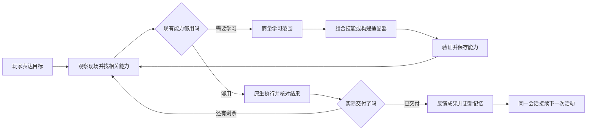
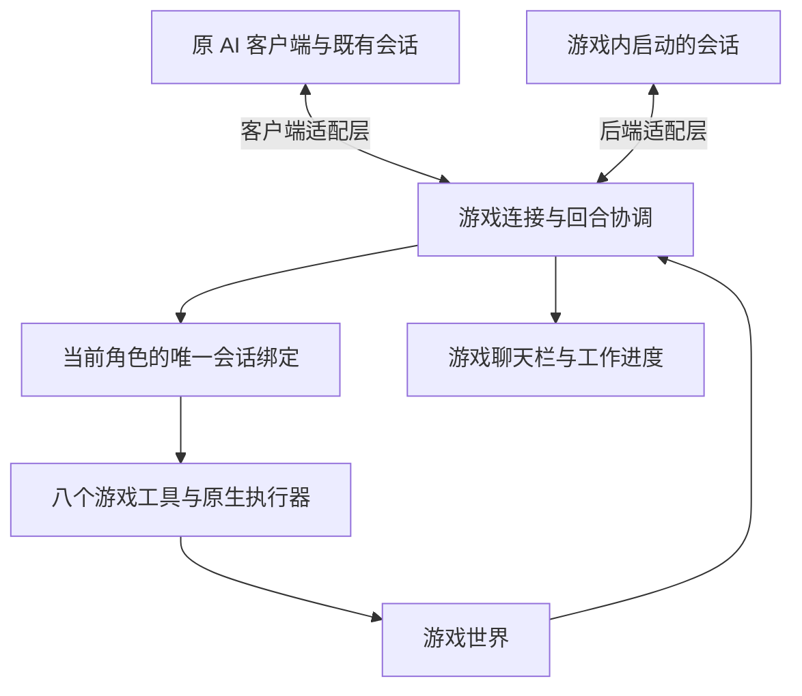

# 星露谷 AI 伙伴效率与可玩性设计

更新日期：2026 年 10 月 30 日

状态：双路径接入与原会话延续首版已实现并完成隔离实机验证；自然语言记忆与方法召回已接入本次源码；原生能力自主生成、构建、热加载、升级与读档复用已完成隔离实机验证

设计基线：0.3.21；以下已实现进度随 0.3.22 发布

下一阶段要让伙伴持续参与玩家的游戏生活：已经会的事情做得连贯，暂时不会的事情可以商量着学，学会之后下次继续使用；重进游戏时自然接上之前的关系、话题与安排。

本设计保留两种入口：**已有 AI 伙伴从原会话主动连接 Mod，以及从游戏内启动伙伴。** 两者共用游戏能力和执行链，持续使用各自的会话；已有伙伴的人格与关系由原客户端保留，游戏提供身体、世界和共同经历。遇到能力缺口，再学习并保存可复用的 skill 或原生适配器。

持续 session 的主要价值是让玩家已经培养好的伙伴继续陪他游玩。保存人格摘要、创建相似的新会话属于迁移，不能当成原会话恢复。自进化则保存经过验证的能力，不涉及训练模型权重。

本文替代旧版设计中针对 0.3.14 的聊天与工作分离假设。0.3.21 已经完成的统一回合、八个工具、即时执行、聊天栏交流与工具边界接收新要求，均作为后续基础。0.3.22 在此基础上交付原会话接入、持续记忆和原生能力成长。

本次补充以模型自主判断为中心：记忆和 skill 均为可修订的自然语言资料，不将习惯编码成条件状态机，不以严格数量差核验完成，跟随由模型组合基本工具。本次源码已实现原生适配器的发现、生成源码提交、独立编译、热加载试用与版本保存回退；具体玩法仍由现场需求与原生接口决定，离线验证不能替代隔离实机验收。参考 OpenAI 的[上下文个性化](https://developers.openai.com/cookbook/examples/agents_sdk/context_personalization)与[会话记忆](https://developers.openai.com/cookbook/examples/agents_sdk/session_memory)示例，将召回资料与持续会话区分，原会话人格继续由原客户端维护。

### 本轮实施进度

- 游戏内可选择“连接已有伙伴”或“由游戏启动伙伴”。切换先停止旧来源，沿用同一游戏执行链；切换和重连均不撤销 F9 接管。
- 已有伙伴首版接入 MiniMax Code 0.6.2：玩家从原客户端环境启动常驻连接适配器，明确选择原会话与原工作目录；Mod 只连接适配器，不替玩家另启一个伙伴。游戏消息和回复写入原会话，不向游戏回放原私人聊天历史。
- 原会话与原角色定义在连接前和每轮执行前核验。原角色缺失、身份变化、连接失效或恢复失败时显示原因，等待明确重连；不改用默认角色或新会话。当前只适配上述客户端版本及已核验的数据结构。
- 游戏聊天与界面使用玩家连接时指定的显示名，切回游戏内伙伴恢复其档案名；连接别名不回写档案，也不重写历史消息的说话者。
- 游戏托管路径保留原会话映射，读档时清除旧执行并刷新世界。外部路径每轮带上完整的精简游戏状态，避免原客户端整理上下文后继续依赖缺失的增量基线。
- 首版连接期间原聊天窗口须保持闲置，玩家在游戏聊天栏继续交流；尚无跨客户端并发锁或一键客户端插件。退出游戏取消游戏回合，适配器可用 `Ctrl+C` 或断开命令结束；随后在原客户端重新打开同一会话，刷新游戏经历后继续聊天。

离线逻辑、本机通信、发行包与实机证据见[双路径接入验证记录](dual-connection-validation.md)，操作见 [MCP 接入说明](mcp.md#已有-minimax-code-伙伴主动连接)。两种来源均完成了连续三个游戏日、实际收获入箱及保存退出重进；原伙伴在退出游戏后，通过原会话且不调用工具回忆了新增约定与游戏成果。执行中 F9 接管后，来回切换来源没有重新启动导航或夺回控制权。

本轮实机同时修复了按数量入箱的参数转换、树已砍倒却返回完成数零，以及外部伙伴沿用内置显示名的问题，并完成对应复测。自然语言经验学习与原生适配器构建、热加载已加入本次源码；具体新增共同玩法的实机效果仍需逐项验收；其他客户端的自动接入、原窗口与游戏并发对话，以及更严格的经历来源与时间顺序记忆，仍需后续适配和验证。

## 1 产品目标与优先级

玩家应当能够说“把菜收好放箱子，弄好来找我”，随后继续自己的活动；遇到新机器时，伙伴可以说“这个我还不会用，想试着学一下”；下次进入存档时，它记得之前的分工，也已经掌握学过的方法。

| 优先级 | 要解决的问题 | 玩家可感知的结果 |
| --- | --- | --- |
| P0 | 已培养的人格无法直接成为游戏伙伴 | 原会话主动连接游戏，原有身份与关系延续 |
| P0 | 重启游戏就重新交接，情境容易丢失 | 重新连接原伙伴，刷新世界后继续 |
| P0 | 一个动作完成后，离玩家要的成果还有几步 | 收获、拾取、入箱、交付形成完整合作 |
| P1 | 已有动作能组合完成新要求，却每次重新摸索 | 成功做法保存为 skill，下次直接复用 |
| P1 | 未覆盖的游戏或 Mod 功能只能回答做不了 | 商量后发现接口、构建能力、验证并接回原目标 |
| P1 | 伙伴能干活，共同活动却不够 | 跟随、等候、会合、递物成为稳定玩法 |
| P2 | 长期目标和共同经历只留在聊天里 | 分工、阶段成果与所学能力影响后续行动 |

每个阶段交付一条能从邀请玩到收尾的旅程。首批学习案例选择新机器、物品交接和已有农活的组合；复杂战斗、完整钓鱼与任意第三方 Mod 兼容不作为首版自进化的完成标准。

明确交代的日常工作直接推进。观察、寻路、补水和原范围内续作由伙伴处理；学习新操作时商量一次，约定清楚后自行构建和验证。玩家需要选择的是玩法、资源用途或新的实际影响，而不是内部技术步骤。

## 2 发布基线与待解决的问题

0.3.21 发布记录报告固定三组伙伴实机回归通过，覆盖浇水补水、中途追加要求、收获拾取入箱出货，以及休息后采木并保留幼树。这是后续连续行动的基础，尚不证明新能力学习、完整跟随或跨启动会话复用已经完成。[0.3.21 更新说明](release-notes-0.3.21.md)、[可重复伙伴实机验收](repeatable-companion-acceptance.md)。

| 已有基础 | 仍需解决的问题 | 本次设计 |
| --- | --- | --- |
| 聊天与工作共用回合、状态和八个工具 | 能力集合仍由开发者预先定义 | 在固定入口下增加能力发现、学习和调用 |
| 动作立即执行并返回终态 | 动作成功与整个目标交付仍有距离 | 把物品去向、会合和可见结果纳入完成条件 |
| 工具边界接收新消息 | 组合技能也要保持可调整、可中断 | 每个原生步骤边界接入消息，现场重算剩余步骤 |
| 聊天栏交流，左上角工作进度 | 学习与记忆缺少自然的产品表达 | 沿用现有入口，补充能力和约定视图 |
| 已有外部工具接入与游戏内后端 | 两边会话分离，不能把游戏消息稳定送回指定原会话 | 双路径接入，共用消息协调和游戏执行 |
| 同一游戏内重连保留会话 | 启动读档仍清除旧模型会话映射 | 保留伙伴会话绑定，重新核对世界 |
| 已有偏好、约定、事件和增量上下文 | 长期存储与当轮展示预算绑定较紧 | 重要记忆归档保留，按当前场景召回 |
| mcode 已有原会话压缩实现 | 后端维护与游戏侧记忆缺少统一策略 | 统一恢复、记忆整理与压缩后基线重建 |

依据主要是 [game_tools.py](../runtime/src/stardew_ai_runtime/game_tools.py)、[chat_bridge.py](../runtime/src/stardew_ai_runtime/chat_bridge.py)、[game_reload.py](../runtime/src/stardew_ai_runtime/game_reload.py)、[companion_memory.py](../runtime/src/stardew_ai_runtime/companion_memory.py) 和 [mcode_compaction.py](../runtime/src/stardew_ai_runtime/mcode_compaction.py)。后续继续复用这些模块，不恢复旧版的只读聊天回合、二次派工准备或持久化动作队列。

## 3 四条相互连接的体验循环

**合作循环：** 表达目标 → 观察现场 → 连续行动 → 中途调整 → 完成交付 → 记录结果。交付包括东西放在哪里、还有什么没做、是否回到玩家身边。

**陪伴循环：** 发出邀请 → 靠近或跟随 → 一起参与 → 交流与分工 → 会合收尾 → 留下共同经历。玩家可以只是想一起走走，不需要附加生产任务。

**成长循环：** 发现不会的事 → 与玩家商量 → 找到能力来源 → 构建并验证 → 接回原目标 → 保存能力 → 下次直接使用。生成文件或编译成功都不是这个循环的终点。

**持续循环：** 同一会话继续交流 → 更新目标与记忆 → 适时整理上下文 → 保存退出 → 读档核对世界 → 接着玩。会话延续情境，记忆保存长期约定，观察提供当前事实。



## 4 玩家如何体验成长与延续

### 4.1 首次遇到新机器

玩家说：“以后帮我照顾这个新装的加工机，成品放旁边箱子。”

伙伴先观察对象、输入输出与周围容器，查找已有能力。若通用机器操作已经适用，只需补充配方和约定；若确实缺少操作入口，再建议学习：

> 这台机器我还不会操作。我可以试着学一下，用箱子里的一份原料试做，成功后记住方法，以后帮你收成品和补料。

玩家可以选“可以”“先别学”，也能回答“可以，但别用金星原料”。答复立即保存，同时明确学习目标和本次试用范围。查接口、构建与验证随后自行推进，不反复要求批准每个步骤。

左上角显示“正在学习这台机器的用法”，聊天只报告关键变化。构建期间可以继续交流，已有照料工作也能正常推进；实际试用与当前动作错开，保持一个游戏执行者。

投料成功后，伙伴说：“已经放进去一份了。加工好后我会来收，放右边箱子。”若需要一夜加工，此时只记录“已验证投料，收取待验证”；次日收取与入箱成功后，再将整套机器照料标为学会。

下次再说“照顾一下机器”，直接检索保存的能力，重新观察现场，不重复学习。若接口不能支持关键操作，说明缺口，完成仍可做的部分，例如准备原料；保留学习记录，等出现新接口或新办法再继续。

### 4.2 学会玩家自己的做法

“以后收菜的时候，金星留下，普通的放出货箱，最后来门口找我。”

如果收获、分类、搬运和会合均已支持，就把成功做法整理成 skill。明确约定且没有新增底层能力时直接保存，不额外弹出学习确认。若会合尚不支持，则说明缺口，不能把写好的步骤说明当成已获得行动能力。

skill 保存可复用步骤与适用条件；具体品质、箱子位置、会合地点从当前存档读取。换一个农场重新绑定，不带入上一存档的箱子或偏好。

### 4.3 重进游戏后继续

玩家昨晚说：“明天先看看新机器，再去镇上。”保存退出后，已有伙伴仍留在原客户端继续聊天；再次连接游戏时收到当前日期、机器状态、原约定和能力版本，接上原计划。游戏内启动路径则恢复它之前保存的会话，取得同样的世界接续信息。

若载入的是加工前的旧存档，之前的加工成果已经不在当前世界。伙伴仍可保留学过的操作方法，但必须重新检查原料和机器，按当前剩余工作行动。

### 4.4 界面保持轻量

首次进入提供“连接已有 AI 伙伴”和“在游戏内启动伙伴”，之后记住选择。已有伙伴连接时展示来自哪个客户端和会话的名称；其人格设置默认沿用原会话。

T 或左侧入口承担自然聊天；NPC 选项和关联自然语言回答承担决策；左上角显示实际行动与学习阶段；F8 保留完整游戏记录，不复制原客户端的私人对话历史。

后续界面规划：F8 补充“学会的能力”和“记忆与约定”。能力卡显示名称、用途、掌握情况、最近结果及暂停使用或重新学习；记忆支持直接改正和忘记，也接受“别按刚才的办法做了”。

普通玩家无需操作 session 编号、接口签名和构建日志。能力暂不可用时，只说明有意义的原因，例如“这个 Mod 更新后需要重新适配”或“这项能力还需要试用核对”。

## 5 自进化的能力分层

### 5.1 先判断缺的是哪一层

| 类型 | 示例 | 产物 | 生效方式 |
| --- | --- | --- | --- |
| 知识或约定缺口 | 不知道配方，或不知道成品放哪 | 指导、配方说明、存档约定 | 更新后在当前会话使用 |
| 组合能力缺口 | 已会收获和存箱，缺整套收尾流程 | 参考现有动作的自然语言 skill | 当前会话按需召回 |
| 接口适配缺口 | 目标 Mod 有公开 API，本项目没有包装 | 查询或动作适配器及配套 skill | 独立编译后在当前游戏热加载试用 |
| 原生行为缺口 | 需要新的交互、事件处理或角色动作 | C# 适配器与验证场景 | 构建后热加载，成功使用后保存供后续游戏加载 |

背包满、天色晚、道路被挡属于现场条件，先处理条件。只有现有操作无法表达所需行为，才学习新能力。相同缺口已有学习在进行或刚确认无法支持时，不重复启动相同尝试。

### 5.2 从 SMAPI 抽取能力的实际含义

SMAPI 注册表可以枚举已加载 Mod，读取标识与版本，并取得其他 Mod 主动公开的 API。公开 API 可能不存在，列出方法也不能自动获得玩法语义。因此本次“抽取能力”实现为：**发现接口，结合文档理解用途，生成本项目能够执行和核验的包装。** [SMAPI 注册表源码](https://github.com/Pathoschild/SMAPI/blob/develop/src/SMAPI/IModRegistry.cs)、[API 集成说明](https://stardewvalleywiki.com/Modding:Modder_Guide/APIs/Integrations)。

能力发现依次检查已有动作、游戏对象的通用交互、目标 Mod 的公开 API，再考虑专门实现原生行为。新 Mod 只增加使用通用机制的物品或机器时，补数据和 skill 往往就够了。

每项包装要说明操作哪个角色、需要什么条件、会改变什么、如何知道成功。读取机器进度可以成为查询；投入原料还需要背包扣减和机器状态变化等证据。反射找到方法，不代表调用它符合实际玩法。

补出的操作复用原生交互、材料和体力消耗、碰撞与动画。不能直接添加成品或改写完成标志，冒充学会玩法。伙伴与 AI 自玩共用能力定义，由运行层绑定实际角色。

### 5.3 完整学习流程

1. **描述缺口。** 记录原目标、缺失步骤、相关对象和预期结果，具体到“把原料放入这类机器”，不泛化成“学会所有加工”。
2. **检索复用。** 查能力库与本地接口目录，优先复用或升级已有项，避免重复生成近似能力。
3. **商量试用。** 说明要学什么、使用哪些资源、成功后怎样继续。玩家已经明确要求学习并给出范围时直接沿用。
4. **构建最小能力。** 生成指导、输入约束、执行逻辑和结果检查，先补当前缺少的一步，再组合成玩法。
5. **试用核对。** 在商量好的范围内热加载并实际调用，可使用当前存档；观察材料、世界与角色行为。编译通过只说明生成了产物，项目开发验收另用隔离存档核验结果、移动碰撞和动画。
6. **激活接续。** 通知当前会话，重新观察原目标，执行仍需要的部分。首次真实使用遵守商量过的资源和影响范围。
7. **持久化改进。** 保存验证过的版本、适用条件和经验。下次优先复用，出现新失败证据再修订，不在每次成功后重新生成代码。

根据明确错误可以修正再试。有新诊断或行为进展就继续；反复得到相同结果时结束本次尝试并说明缺失条件。以进展判断是否继续，既不以过短总时限打断构建，也不无意义地反复调用模型。

### 5.4 游戏会话与构建进程的分工

游戏会话理解目标、商量选择，通过 `consult.inspect_capabilities` 取得真实接口与作者契约，生成适配器源码；`manage_arrangements.develop_capability` 将源码交给独立本地编译进程，返回产物或诊断。模型据此修订，实际玩法由游戏内调用验证。

构建输入包括缺口、相关 API 和版本、已有适配器示例、玩家试用约定与预期结果；输出是能力包和验证记录。游戏模型仍只使用八个游戏入口，通过 consult 取得指导，不修改各模型客户端工具配置。

玩家可以在当前存档、约定的资源和影响范围内试用新能力。项目开发与发行验收使用独立存档、运行目录和连接，并装载匹配版本的目标 Mod；这项开发要求不作为每次游戏内成长的前置门槛。

方法记忆直接供模型参考，无须技能解释器；原生扩展才需要对应 API 绑定。新的 C# 适配器还需要可用的 .NET 构建环境、项目契约与本机游戏引用；已有 Python 运行环境不等于具备任意 C# 构建能力。缺少构建环境返回 `setup_required`；玩家同意本地准备环境后，调用 `manage_arrangements.prepare_capability_builder`，复用兼容 SDK 或下载官方 SDK 并校验，后续构建直接复用。

本次已实现专用程序集宿主：`manage_capability(action="try")` 将编译版本热加载到当前游戏，成功调用并核对后用 `keep` 保存供后续游戏加载；`rollback` 恢复上一已保存可用版本。它加载符合本项目 `IGameExtension` 契约的能力包，不承担任意 SMAPI Mod 的热加载。自然语言方法随召回直接使用。

学习状态可以持久化，下次继续构建或查看结果；游戏动作始终立即执行，不增加持久化动作工单。退出时取消模型执行与当前试用，清理所属进程；下次从保存的产物继续，不恢复旧导航或盲目重放试验动作。

## 6 在八个工具入口内扩展

保留现有八个名称，增加少量固定内部操作。动态能力通过目录描述用途和输入，通过统一入口调用，不为每个 skill 新增顶层 MCP 工具。下表说明本次源码已接通的能力学习操作；顶层名称与参数形状保持原有契约。

| 现有入口 | 新设计职责 |
| --- | --- |
| `get_status` | 当前动作与控制状态 |
| `query_game` | 新能力提供的观察、对象类别及可用交互；查询不改变世界 |
| `submit_work` | `action.learned_action` 即时调用已加载原生能力，返回终态与相关观察 |
| `manage_arrangements` | `change.develop_capability` 编译；`change.manage_capability` 试用、保存或回退；`change.prepare_capability_builder` 准备环境 |
| `remember` | 对话、选择和有依据的记忆修订，学习结论关联能力版本 |
| `request_player_decision` | 商量学习及试用范围，接受选项或自然回答 |
| `consult` | `request.inspect_capabilities` 查询能力版本，读取源码、指导、输入约束、原生类型或 Mod 公开接口与作者契约 |
| `read_reload_history` | 按需查看旧存档分支、结果与交接记录 |

### 6.1 固定扩展调用契约

查询使用 `query_game(query={"learned_query": {...}})`，动作使用 `submit_work(action={"learned_action": {...}})`。发现使用 `consult(request={"inspect_capabilities": {...}})`，构建与版本操作使用 `manage_arrangements(change={"develop_capability": {...}})` 或 `change.manage_capability`。这表示在现有入口的参数对象中新增具名操作，不是新增工具名。请求指定已注册能力、版本和参数；参数由对应能力自己的 schema 校验，不退化成任意代码或任意反射方法调用。

概念示例：

```json
{
  "action": {
    "learned_action": {
      "capability": "machine.insert_input",
      "version": "1.0",
      "arguments": {
        "target": "当前观察返回的机器引用",
        "input": "当前背包中的原料引用",
        "quantity": 1
      }
    }
  }
}
```

能力与版本由目录给出，实体引用来自当前观察。角色、存档、原要求和执行权限由程序绑定，执行时复用忙碌、暂停、接管与读档检查。

结果沿用原生动作语义：做了什么、实际消耗和产出、剩余部分、结束原因与相关观察。能力操作成功不自动标记原目标完成。缺失回执时先查询动作和世界，不能当成零产出后直接重做。

### 6.2 skill 的使用方式

skill 是模型可参考、可持续修订的自然语言方法，记录适用场景、经历和操作建议。例如收获后检查掉落物、背包与存放约定，再决定拾取或入箱。模型自主组合现有工具，不增加解释器、固定条件状态机、严格数量验收或预设跟随行为。

本次源码实现按存档和伙伴隔离的记忆与方法保存、修订、遗忘和相关召回；当前消息与场景帮助选取记录，修订通过同一会话的后续上下文送达。旧经历保留供理解关系和学习，失效约定不再默认召回。原生观察仍决定当前事实，玩家操作也会改变世界，数量变化不直接证明伙伴的贡献或失败。

跟随、会合与协作由模型观察位置并组合基本动作；底层缺少跨地图移动、递物或机器交互能力时，明确指出缺口，再增加 SMAPI 原生能力。模型通过真实接口生成 C#，构建工具编译后交由宿主热加载；共同玩法由模型按现场组合，未新增常驻跟随执行器。暂停、取消和 F9 接管仍由既有执行边界保障。

### 6.3 原生适配器接入

适配器把有语义的操作映射到游戏或目标 Mod 原生行为，沿用角色适配层与动作状态机。游戏对象访问和变更回到游戏线程，构建进程负责生成产物。

动作可取消、可结束并返回实际结果；失败后释放执行权。后台事件订阅和临时导航随动作结束清理，避免重新出现旧导航抢占。新能力使用操作所需的宿主服务，首版不提供任意 shell 或文件执行作为游戏动作。

## 7 能力持久化与后续使用

能力包包括用途、输入约束、实现或配方、相关依赖版本、验证结果与使用经验。实现和指导一起版本化，目录只指向已激活版本；修改中间产物不影响正在执行的旧版本。

能力保存在现有运行目录的用户数据区：

```text
data/abilities/
  catalog.json
  packages/<能力标识>/<版本>/
    manifest.json
    skill.md
    Adapter.cs
    adapter.dll
    provenance.json
    verification.json
  learning/<构建记录>/
    build.json
    compiler.log
```

这些文件保存能力知识和构建结果，不保存待执行动作列表。实际目标、控制状态和成果继续复用现有存储。

| 内容 | 作用范围 | 下次使用方式 |
| --- | --- | --- |
| 通用交互与搬运实现 | 本安装能力库 | 按相关游戏、SMAPI、Mod 依赖检查可用性 |
| 箱子、田区、物品用途 | 当前存档 | 从当前世界重新绑定对象 |
| 偏好与学习试用约定 | 当前玩家与存档 | 按有效约定执行，不从其他存档继承 |
| 成功或失败的游戏结果 | 对应存档与读档分支 | 用作经历或诊断，不作当前库存事实 |
| 构建和验证记录 | 对应能力版本 | 支持修订与恢复上一可用版本 |

同一能力跨启动复用，也可在兼容的其他存档中被发现。新存档仍需建立当地的物品去向和使用安排，能力存在不意味着自动操作新农场。

能力状态用“学习中、可以试用、已学会、需要适配”表达，内部记录实际验证范围。投料成功不等于整个生产循环验证成功；完成一次完整场景后启用相应能力，遇到新条件再扩展。

加载时只检查能力声明的相关依赖，不因无关 Mod 变化废弃全库。缺失或不兼容的依赖让相应能力暂不可用，重新适配后针对性验证。首次支持范围以实际验证版本为准，不由一次成功推断所有未来版本。

能力数据由安装更新和程序文件恢复流程保留。切回上一能力版本恢复的是实现，不能撤销已发生的游戏变化。后续导出可以包含可复现源码、配方和契约，不包含存档、私人路径或游戏程序集。

## 8 双路径接入与持续会话

### 8.1 保留两种入口

两条路径分别服务于已经有 AI 伙伴和希望直接开始游戏的玩家，共用 Mod、观察、八个游戏工具、原生执行、能力库和农场记忆。

| 接入方式 | 玩家入口 | 谁主持模型会话 | 适合的体验 |
| --- | --- | --- | --- |
| 连接已有 AI 伙伴 | 在原对话中说“连接我的星露谷农场”，或在游戏选择等待已有伙伴连接 | 原 AI 客户端及其原会话 | 已培养好人格，希望原来的伙伴进入游戏 |
| 在游戏内启动伙伴 | 在游戏选择后端并启动伙伴 | 项目的运行时，通过所选后端创建或恢复游戏伙伴会话 | 无需先打开外部对话，直接开始一起玩 |

第一条路径由原 AI 客户端发起连接，Mod 提供可发现的游戏服务，连接后双方交换消息与事件；第二条路径由游戏侧运行时发起模型调用。区别在于谁拥有和调度模型会话，而不是所有消息只能沿一个方向流动。

两种入口可以同时安装和准备，但同一角色同一时刻只有一个会话拥有游戏执行权。首次设置展示两个选择，之后记住玩家选择；选择等待已有伙伴时，不在后台另起内置 AI 代答。

这里的接入来源与“伙伴模式 / AI 自玩模式”是不同设置。角色模式仍按现行约定重启生效；接入来源可以通过明确的断开和连接流程切换，不借此改变角色或夺回 F9 接管权。

### 8.2 连接的是原伙伴及其环境

本功能的主要目的，是让玩家已经培养好的会话获得游戏中的身体。不能仅导出人格摘要，再创建一个游戏专用会话就宣称原伙伴已连接。

原会话中的人格可能依赖历史对话、角色指令、长期记忆来源、模型与客户端配置。因此已有伙伴路径优先由原客户端继续运行，项目只提供游戏能力、状态与消息桥接。游戏不得用默认伙伴模板覆盖它的身份、称呼和表达习惯，也不擅自切换模型或替换原角色配置。

连接时增加的是场景说明：“你现在通过这个角色与玩家一起游玩，沿用原对话中的身份和关系，以下是当前游戏状态与操作规则。”游戏规则约束操作和游戏事实，不重新定义人格。姓名、称呼和语气设置默认沿用原会话，玩家在游戏内明确提出的改变再反馈到原会话。

绑定关系分为两层：**伙伴绑定原会话与客户端身份，存档绑定世界记忆。** 同一原伙伴可以随玩家进入不同存档，各农场的箱子、库存、田区与经营目标分别保存；切换世界不要求创建新人格。

若某后端支持从项目运行时恢复指定外部会话，可作为第二种技术接法，但必须同时保留其必要角色配置和记忆环境，并与原客户端协调执行。首版优先做好原客户端直连，不把“填入 session ID”作为通用人格接入方案。

### 8.3 已有伙伴的连接过程

1. 游戏加载存档，启动本地游戏服务；原 AI 客户端在玩家邀请后发现服务。首次工具连接按客户端实际能力配置一次，之后复用，不由 Mod 反复改写客户端全局配置。
2. 客户端适配层提交原会话的连接标识与显示名称，绑定当前游戏角色。无需把原始私人对话复制到 Mod；会话在原客户端继续保存。
3. 游戏返回当前世界、有效农场约定、控制状态、工具指导和相关能力。原会话确认接收后进入可游玩状态。
4. 玩家在游戏聊天栏发言，消息由适配层投递到这个原会话。该会话读取观察、调用游戏工具、把面向玩家的回复送回聊天栏，执行结果继续回到原对话。
5. 退出游戏时结束本次游戏行动、取消游戏触发的待处理回合并断开游戏连接。原客户端和原会话继续存在，玩家可以接着聊其他内容。

项目只清理自己启动的进程，不关闭玩家原先打开的 AI 客户端。若客户端不能取消特定回合，游戏侧先撤销它的游戏执行权，防止退出后迟到的调用继续操作。

MCP 工具连接本身不保证客户端会在玩家发消息后自动开始推理。完整接入还需要客户端适配层，负责原会话消息投递、回合唤醒、结果返回和取消。首版选择一个支持这些能力的客户端跑通；只支持手动调用游戏工具的客户端，明确显示为手动交互连接，不冒充完整自动陪玩。

连接握手由本地服务与客户端适配层处理，不增加顶层模型工具。模型侧仍使用八个入口；状态查询和安排管理可承载必要的连接状态与控制操作。

### 8.4 游戏内启动路径

保留目前从游戏设置选择后端、启动运行时的便捷路径。首次创建游戏伙伴会话，后续启动默认恢复；聊天、派活、学习完成、约定修改和跨日继续同一会话。

现有 `chat_sessions.json` 的后端与存档映射可迁移为运行时管理的伙伴绑定，记录后端连接身份与恢复信息。账户、工作目录不同不能假设同一会话编号可用，游戏进程编号不参与长期会话归属。

该路径使用游戏内人格配置，并可逐步形成自己的长期关系。它与“连接已有伙伴”是玩家可选择的来源，不应在原伙伴失联时偷偷启用。未来可让玩家把游戏内创建的会话在支持的客户端中继续打开，但是否可行由后端实际恢复能力决定。

### 8.5 两条路径共用执行与消息协调



两种适配层接入同一套游戏侧消息协调、观察和执行逻辑。原客户端主持的会话不再由内置后端调用第二个模型代答；运行时主持的会话继续使用现有后端链路。

游戏内外输入由会话拥有者统一排序。同一 session 不同时启动两轮推理；每条游戏消息保留投递标识，重连只补未确认内容，自己的回复回显不再次当作玩家输入。主动工作和事件也交给当前会话，由同一个伙伴决定与表达。

连接来源切换必须由玩家明确发起：让旧动作结束或按玩家要求取消，停止旧来源追加工作，释放角色绑定，再连接新来源并发送当前状态。已完成成果继续按真实观察保留。若新来源不是原会话，界面说明正在更换伙伴，不能把复制历史当成同一会话切换。

当前来源断线时，执行器让已接受动作正常收束，保留结果，不自动重放或把角色交给另一条路径；暂停、取消和 F9 接管仍可阻止后续行动。界面显示当前伙伴及连接状态，不要求玩家管理内部编号。

### 8.6 会话延续与世界刷新

| 概念 | 何时变化 | 变化后做什么 |
| --- | --- | --- |
| 原会话引用 `providerSessionId` | 玩家选择新会话或明确迁移 | 原客户端或后端提供可验证的会话引用，不由模型自报身份 |
| 世界代次 `worldEpoch` | 重载或切换存档 | 废弃旧动作上下文，核对当前世界 |
| 上下文基线 `contextRevision` | 完整重建或增量确认送达 | 确保后续增量有正确参照 |

原会话引用也可以是客户端提供的稳定绑定句柄，不要求所有平台暴露相同形式的 session ID。产品应能确认仍在向原会话投递，而不是只凭 AI 说“我记得你”。

读档时停止旧世界的游戏执行，恢复该存档目标与已保存结果，清除旧实体引用。已有伙伴路径等待或恢复原客户端连接；游戏内路径恢复原后端会话。两者随后都清除增量基线，发送当前日期、控制权、农场约定、相关能力和必要观察，并说明读档撤销的旧成果。

确认送达后再建立基线并处理已授权安排。同一游戏内普通网络重连不增加世界代次；旧世界回执不能进入新世界。F9 接管与暂停不会因恢复连接被清除。

| 场景 | 已有伙伴路径 | 游戏内启动路径 |
| --- | --- | --- |
| 聊天、派活、跨日、学习成功 | 原会话继续 | 当前游戏伙伴会话继续 |
| 保存退出再进入 | 原会话重新连接身体，刷新世界 | 恢复保存的会话，刷新世界 |
| 玩家带伙伴进入另一存档 | 原会话继续，换该存档的世界记忆 | 按玩家选定伙伴绑定恢复，不自动把不同伙伴合并 |
| 原会话失联或恢复失败 | 等待原连接，不启用其他 AI | 重试原会话，提供明确的修复或新会话选择 |
| 上下文接近容量 | 由原客户端维护原会话 | 通过后端已支持的原生维护能力处理 |
| 迁移到新会话或新后端 | 玩家明确选择，并说明会话已迁移 | 玩家明确选择，不静默替换 |

### 8.7 原 session 内的记忆与压缩

原伙伴的人格和关系记忆留在原客户端，由它自己的机制维护。项目保存农场约定、实际成果和能力经验，通过当前会话反馈必要更新。游戏经历自然进入原对话，不将日常私人历史导出到每个存档。

持续追加摘要不会缩短历史。已有伙伴路径由原客户端负责压缩，项目不并行启动另一进程强行维护其 session；客户端若能报告上下文重置，就通知游戏重建基线。无法可靠检测压缩的接入使用自足的紧凑游戏状态包，不依赖可能已经丢失的增量参照。

游戏内路径复用已有 mcode 原会话压缩，其他后端明确报告恢复、压缩和用量统计能力。维护顺序为保存重要结果、整理当前摘要、在合适边界进行原生压缩、确认仍是原会话、重建上下文基线，再补必要观察和记忆。

时机按最近请求的实际输入上下文与后端容量留出下一轮空间，不累加历史计费 token，不按固定消息数或每次换日重开 session。维护与同一会话推理串行进行，不强行打断正常原生动作。

原会话不能继续时保留绑定与记录，提供恢复或明确迁移选项。新会话即使导入完整摘要，也显示为迁移后的会话，不称为恢复原会话。项目可以保证连接对象与处理路径的连续，不能承诺模型在压缩、升级后表达完全不变。

### 8.8 送达与执行分别确认

保留 `prompt_delivery.py` 的原则：动作失败不等于输入未送达，确认送达后才推进基线。客户端适配层报告的是消息确实进入绑定会话，而不只是进入本地待发送列表。

恢复时动作结果不明，先查执行器和世界，判断是否已经产生效果，再处理剩余操作。读档、压缩和明确更换会话均重建上下文；记忆修订与能力变化也纳入待确认内容，不能因为文件已保存就假设原会话已经知道。

## 9 持续更新的记忆

本节描述项目负责的游戏记忆。已有伙伴的人格、关系与私人日常记忆仍由原客户端维护，游戏只投递共同经历和明确的新约定；游戏内创建的伙伴则沿用项目自己的配置与记忆机制。切换接入来源不自动合并两个伙伴的个人记忆。

### 9.1 三类长期内容和一份当前摘要

| 内容 | 示例 | 更新方式 |
| --- | --- | --- |
| 玩家约定 | 保留幼树，金星作物留给玩家 | 明确表达后立即保存，改变时替换旧约定 |
| 共同经历与目标进展 | 一起搭好休息区，新机器完成首次加工 | 根据原生结果或已确认事件记录 |
| 能力经验 | 机器需留一个空位，某版本不支持收取 | 随验证与实际失败结果更新 |
| 当前工作摘要 | 先收成品再去镇上，门口箱子已满 | 目标变化、动作终态、读档和压缩前更新 |

长期存储与每轮提示词分开。当前实现对约定、偏好和事件设固定条数并限制展示长度；后续应将展示预算保留为上下文控制，重要记录通过归档和检索保留，不因普通事件增加而挤掉关键约定。

完整聊天留在现有历史，不把每条闲聊都转换为记忆。首版按存档、地点、目标、对象和能力标识检索即可；数据规模与效果确有需要时再引入语义检索。

### 9.2 写入与召回

玩家明确改约定或回答选择时立即写入。动作终态记录客观结果，目标结束时补充有价值的经历。对话出现可长期使用的偏好才整理，不为每条消息额外调用记忆模型。

每轮读取有效约定、当前目标和少量相关经历；调用某能力时再读取其指导。约定未变不重复发送，玩家刚改正的内容优先于旧摘要。上下文不足时先压缩普通经历，保留本轮相关的资源保留、交付和控制权约定。

记忆更新支持新增、修订和撤销，关联来源与版本。“不是门口箱，是屋里那个”应替换原目标的存放约定，不能留下两句相互冲突的指令让模型猜。玩家否定一条推测后，后续摘要和召回都应使用修订结果。

### 9.3 读档后哪些内容有效

关系、表达偏好、已明确保存的长期约定和通用方法可以保留。原料数量、施工完成、机器产出等世界事实回到存档核对；没有进入本次存档的成果留在历史中，标记为旧分支经历。

伙伴可以记得“我们试过这种加工方法”并复用 skill，不能因此说“箱里已有昨天的成品”。当前世界未完成的步骤才需要继续，不能根据旧 session 对话机械重播整个流程。

模型可以提出记忆摘要，事实与执行结果仍以原生观察和回执为准，保留已有系统事件写入边界。玩家在 F8 或聊天中改正、撤销记忆后，存储和当前会话一起更新，撤销内容从默认召回中移除，不能在下一次摘要中重新生效。

### 9.4 能力经验与个人约定分开

新能力成功后保存两种信息：能力库记录“怎样操作这类机器”，存档记忆记录“玩家要把成品放右边箱子”。后续检索能力、绑定约定、观察现场，再执行。

失败也要区分原因：原料不足更新当前工作，接口变化更新兼容状态，玩家改变用途更新约定。不能把临时缺料学成“这台机器无法使用”，也不为每次箱满重新生成适配器。

## 10 效率与可玩性场景

### 10.1 收获到交付

“把门口成熟的菜收了，金星留给我，剩下放箱子，弄好来找我。”

伙伴识别范围，收获和拾取，按背包核对数量，分类交付并会合。箱满时完成不受影响的部分，商量剩余去向；中途修改品质规则，只影响未完成的交付。

这条流程先用已有动作跑通，再提炼 skill。汇报采用真实去向，例如“8 个放箱子，2 个留给你，还有 1 个因箱满在我身上”。玩家不用逐次提醒收获后拾取、拾取后入箱。

### 10.2 早晨分工到傍晚会合

“我去钓鱼，你照顾菜和机器，晚上在门口碰头。”

伙伴优先完成当天照料，按天气跳过无须浇水的工作，使用已学机器能力。后台构建另一项能力不阻塞既定照料，问进度时直接利用现有结果回答。

傍晚按约定会合，说明成果和剩余。睡觉与推进日期由玩家掌握；次日在同一会话根据新状态继续，玩家不必重新描述田地和分工。

### 10.3 一起出门与递物

“跟我去镇上，顺便买这块田缺的种子。”

模型观察玩家位置、距离和路线，自主组合已有移动工具跟随、会合或等候，并处理采购选择与交流。商店关门时保留采购目标，继续陪伴，不因支线做不了结束整次出行。

附近递物、工作后找玩家和等候是首批可玩性能力。先做稳定原生实现，再交给 skill 组合。陪伴收益应与学习功能一起进入版本安排，不等一个能生成所有工具的平台完成。

### 10.4 一起改造农场

“这里做个休息区，保留这棵树。”

伙伴提出简短布局与材料说明，确认后施工；“椅子往左一点”更新剩余布局。新家具交互未覆盖时，可以商量学习，再接回原改造目标。完工包含带玩家看现场并实际使用，不能只以最后一次放置成功收尾。

## 11 减少等待的执行原则

**减少重新解释。** 原伙伴继续原会话，世界按存档刷新，明确约定持久化，能力按场景检索，避免每次发送全部历史、整个地图和所有能力说明。

**减少重复推理。** 本地处理移动动画，批量动作处理明确的一批工作，模型参考 skill 自主安排短流程。模型主要判断目标、变化、分支和交付。

**在正确边界接入消息。** 玩家补充要求优先进入下一工具边界，普通闲聊不取消正常动作；计划变更影响后续步骤，暂停、取消与接管保留已有语义。

**学习不阻塞日常。** 构建进程处理代码，角色继续已授权工作；构建结果通过能力变化通知当前会话，实际试用才占用游戏执行器。

**有进展才继续投入。** 沿用无响应间隔识别卡住，不用总工作时长打断正常动作。学习也记录新诊断与验证进展，相同失败没有新信息时结束本次尝试。

效率看完整目标的等待、模型回合、实际用量与救场次数。减少工具数量或提示词长度只是手段，不能用更短回复掩盖目标没完成。

## 12 代码落点与迁移

### 12.1 复用现有模块

| 位置 | 设计改动 |
| --- | --- |
| `runtime/src/stardew_ai_runtime/chat_bridge.py` | 将游戏消息协调与模型调用分开，接入原客户端和内置后端两种驱动；维护当前伙伴绑定与投递确认 |
| `runtime/src/stardew_ai_runtime/mcp_server.py` 与客户端连接适配层 | 共用八入口，发现游戏服务，绑定原会话，桥接消息、事件与取消；客户端适配层为新增模块 |
| `runtime/src/stardew_ai_runtime/game_reload.py` | 保留存档核对与旧结果归档，正常读档改为保留会话并重建世界上下文 |
| `runtime/src/stardew_ai_runtime/agent_backends.py` | 承担游戏内启动路径的恢复与维护；原客户端直连不再通过这里另起模型代答 |
| `runtime/src/stardew_ai_runtime/mcode_compaction.py` | 复用现有原会话压缩 |
| `runtime/src/stardew_ai_runtime/prompt_delivery.py` | 记忆和能力变化纳入确认送达，读档与压缩后重建基线 |
| `runtime/src/stardew_ai_runtime/companion_memory.py` | 分离长期保存与展示，增加相关召回和修订撤销投递 |
| `runtime/src/stardew_ai_runtime/game_tools.py` | 保留八入口，增加学习管理与扩展查询、动作的固定内部操作 |
| `runtime/src/stardew_ai_runtime/work_state.py` | 复用目标、控制与成果，学习后按实际剩余续作 |
| `src/StardewAI.Companion.Mod/Discovery` 与 `Observation` | 发现对象、Mod 元数据及接口，提供有范围的能力目录 |
| `src/StardewAI.Companion.Mod/Adapters` 与 `Execution` | 承载适配器，复用角色、执行权、取消与结果语义 |
| `src/StardewAI.Companion.Mod/Navigation` 与 `Menus` | 跟随、会合、递物，以及能力和记忆展示 |

后续原生能力目录与构建服务可独立成模块，不另建游戏目标管理器、聊天体系或动作队列。首版继续沿用现有文件存储习惯，不为能力学习引入额外服务集群。

### 12.2 会话迁移

先把游戏事件和消息协调从内置后端调用中分离，新增原客户端连接适配层；沿用八个工具和原生执行器，不另建一套外部玩法。首版选择一个能向原会话投递并唤醒回合的客户端，跑通原会话连接、游戏内外对话、退出后继续聊天。

游戏内路径保留现有启动入口，将旧映射迁移为受运行时管理的伙伴绑定。正常读档保留会话并刷新世界；若旧版已清空映射，则明确进入首次创建或恢复选择，不把新建标为恢复。

随后统一记忆修订、读档与压缩后的基线重建。mcode 原生维护可先用于游戏内路径；外部路径遵循原客户端维护能力。两条路径分别核验，不以一个后端通过代替所有接入方式。

### 12.3 能力学习迁移

先使用本次自然语言方法记忆自由组合已有工具；真实玩法暴露缺失底层能力时，再设计对应原生接口与针对性验证。公开 API 发现与原生适配构建属于后续扩展。

构建服务先支持一种清楚的 API 包装模板，配一个隔离机器场景，稳定后扩展模板。第一版不要求仅凭任意方法签名理解所有 Mod。

### 12.4 同步项目约定与提示词

本轮已同步更新 `AGENTS.md`、首页、玩家指南、MCP 说明，以及实际加载的 `docs/agent-core-instructions-draft.md` 与领域指导，把“启动读档新建会话”改为“按所选来源连接或恢复原伙伴，并重建世界上下文”。已有伙伴使用场景与工具指导，沿用原身份和表达；游戏内创建伙伴保留人格配置入口。

实际加载的核心提示词与接入 skill 已说明记忆、方法和原生能力的区别，指导模型复用、商量学习、热加载试用与核对结果，并通过 consult 读取能力指导和作者契约。八入口、原生执行、游戏内信息来源、接管和确认送达约定继续保留。

操作说明与 0.3.22 完整发行包同步；运行提示词启用已接通的会话、来源与能力学习操作；具体玩法与界面规划仍按实现和验证状态分别记录。

## 13 分阶段交付

### 第一阶段 原伙伴能进来并持续陪玩

当前进度：MiniMax Code 0.6.2 原会话接入与游戏托管路径均已完成下述实机旅程，详见本轮验证记录。首版要求原聊天窗口在接入期间保持闲置；通用客户端接入和跨客户端并发协调不属于本轮已实现范围。

先交付一个原客户端的完整连接：从已有对话进入游戏，在游戏聊天栏继续交流和行动，退出后回到同一对话；原角色指令和记忆来源保留。原会话失联时等待重连，不自动创建替代会话。

同时保留游戏内启动路径，完成其会话恢复、世界刷新和 mcode 压缩后接续。验证两条路径的选择、明确切换和唯一执行权；无需同时支持所有客户端。

两种路径各走一次完整收获入箱，并连续游玩三个游戏日，包含保存退出和交付约定修改。重新连接无需重复介绍关系或分工，不重复已保存成果，为学习建立稳定基础。

### 第二阶段 学会可复用的做法

交付可检索、可修订的自然语言方法记录，不交付业务流程解释器。选现有动作已覆盖的收获分类入箱流程，从玩家约定、成功执行到重进后复用，增加能力视图。

跟随、会合或附近递物至少交付一条完整原生玩法，并与工作 skill 组合。玩家应感到合作更省心，而不仅是多了能力列表。

### 第三阶段 补上真正缺失的能力

本次源码已接通原生类型与 SMAPI 公开 API 发现、玩家约定、源码编译、热加载试用和持久化。开发验收选可用公开接口走“发现 → 商量 → 生成编译 → 当前游戏试用 → 原目标续作 → 保存 → 重进复用”，并核对版本回退与 F9 接管。

能力宿主与构建环境的首次配置包含在本阶段，开发者手工修改业务代码后可用不能算自进化完成。首例完成后再扩展模板。

### 第四阶段 学会并持续改进

交付相关记忆召回、依赖变化后的针对性适配，以及共同采购或农场改造。用另一个未预先编写业务逻辑、但属于已支持接口类型的场景，验证学习机制能够迁移，而非只识别演示对象。

再根据使用频率选择社交、节日、矿洞或钓鱼。自进化降低新增能力接入成本，高频玩法仍值得由项目提供稳定原生实现。

## 14 验收与效果判断

实现后的代码检查与实机验收分别记录。现有 care-guidance、harvest-logistics、rest-forestry 三组隔离回归继续作为基础，再增加以下完整旅程。

| 旅程 | 核心通过条件 |
| --- | --- |
| 原伙伴主动连接 | 原客户端的会话引用与角色配置保持，游戏输入、回复和行动结果进入原对话 |
| 游戏内启动伙伴 | 无需预先打开外部会话即可游玩，后续恢复保存的游戏伙伴会话 |
| 原伙伴失联 | 等待原连接，不另起模型代答或自动切到游戏内伙伴，重连不重复消息和动作 |
| 明确切换接入来源 | 旧来源停止追加行动，成果保留，新来源取得唯一执行权，不绕过 F9 接管 |
| 保存退出再进入 | 会话拥有者确认连接原会话，约定与目标延续，当前观察重建，不重复交付 |
| 退出后继续原对话 | 原客户端不被关闭，游戏经历留在原会话，日常聊天可继续 |
| 回到较早存档 | 旧成果不作当前事实，通用技能保留，按实际剩余续作 |
| 改约定后压缩 | 新要求及时生效，压缩保留会话标识，旧约定不复活，增量基线重建 |
| 组合 skill 学习复用 | 首次完成目标，下次不重新生成，修改、暂停、取消仍有效 |
| 新机器能力学习 | 商量后完成发现、构建、热加载试用，实际材料与机器状态正确，回到原目标交付；开发验收使用隔离存档 |
| 重启后使用能力 | 保存的能力与适用条件保留，重新加载成功，对象按当前世界绑定 |
| 跟随出门再会合 | 跨地图保持合理距离，不挡路，支线做不了仍陪伴，交接真实发生 |

新增原生能力分别核验结果、物品变化、移动碰撞与动画，避免数量正确但角色没真正操作。会话恢复检查客户端或后端提供的真实会话引用、角色配置和世界行为，不能仅凭伙伴说“我记得”判断成功。还要检查原客户端与游戏内同时输入时只有一条推理执行线，游戏只回显面向玩家的回复，不转发原会话全部私人历史。

针对性测试覆盖真实行为边界：旧世界回执进入新读档、未确认送达推进基线、能力失败不释放执行权、依赖变更后仍调旧接口。复用跨语言只读样本，不堆叠简单赋值或重复参数组合测试。

记录完整目标完成率、被迫重复指令与救场次数、首个可见动作等待、交付时间、模型调用和实际用量。另看正常重进是否复用会话，以及学习成功后是否再次使用。首次学习成本与后续使用成本分开，不能只报快速复用而忽略构建投入。

不预设缺乏基线的百分比承诺。用相同模型和可比存档对照 0.3.21：重复解释应减少，学过的流程不从头摸索，玩家能继续自己的活动。未执行的验收在对应版本记录中如实注明。

## 15 参考依据

### 本项目

- [0.3.21 更新说明](release-notes-0.3.21.md)：本次基线与已有实机结果。
- [可重复伙伴实机验收](repeatable-companion-acceptance.md)：三组场景与隔离验证方法。
- [玩家指南](companion-guide.md)、[自主生活与农场改造](farm-projects.md)：当前入口、持续经营与能力范围。
- [游戏工具](../runtime/src/stardew_ai_runtime/game_tools.py)、[读档核对](../runtime/src/stardew_ai_runtime/game_reload.py)、[增量送达](../runtime/src/stardew_ai_runtime/prompt_delivery.py)：固定入口、即时执行与状态一致性。
- [伙伴记忆](../runtime/src/stardew_ai_runtime/companion_memory.py)、[后端适配](../runtime/src/stardew_ai_runtime/agent_backends.py)、[mcode 原生压缩](../runtime/src/stardew_ai_runtime/mcode_compaction.py)：会话和记忆可复用基础。

### 外部项目与接口

| 来源 | 设计启发 | 本项目采用方式 |
| --- | --- | --- |
| [用户提供的 NagiBridge 二改版视频](https://www.bilibili.com/video/BV1TwHS6rEMZ/)与 [NagiBridge-Remix README](https://github.com/pendel001/NagiBridge-Remix/blob/master/README.md) | 本地联机伙伴、原生聊天与会话记录；具体功能范围以仓库说明为依据 | 强化共同活动，自动管理会话恢复 |
| [NagiBridge-Remix 意图选项单](https://github.com/pendel001/NagiBridge-Remix/blob/master/INTENT-MENU.md)与[工具手册](https://github.com/pendel001/NagiBridge-Remix/blob/master/scripts/TOOL_INVENTORY.md) | 现场可执行候选，物品和社交互动组织 | 按对象与目标检索能力，接入八入口 |
| [StardewValley-MCP](https://github.com/amarisaster/StardewValley-MCP) | 跟随等活动模式，本地即时行为与直接角色控制 | 高频移动和角色动作留在本地，模型选择活动目标 |
| [Voyager 项目与论文介绍](https://voyager.minedojo.org/) | 可复用可执行技能库，以环境反馈改进程序，并在新世界复用 | 保存经验证的 skill 与适配器，以玩家需求驱动学习并回到交付 |
| [SMAPI IModRegistry](https://github.com/Pathoschild/SMAPI/blob/develop/src/SMAPI/IModRegistry.cs)与 [API 集成文档](https://stardewvalleywiki.com/Modding:Modder_Guide/APIs/Integrations) | 已加载 Mod 与公开 API 的发现接口及条件 | 结合原生适配、依赖版本与实际效果验证 |

外部项目提供交互和组织思路，不能直接证明本项目兼容性或实机效果。NagiBridge-Remix 使用 PolyForm Noncommercial 许可；本设计借鉴体验与能力组织，具体实现沿用本项目结构。
